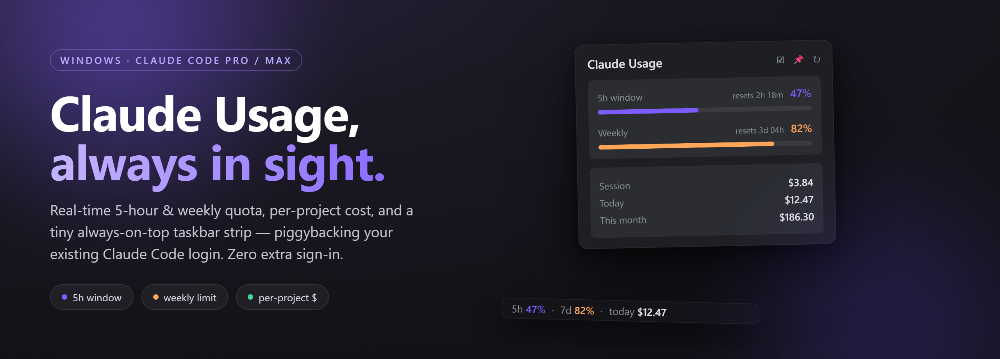
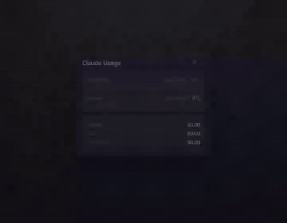
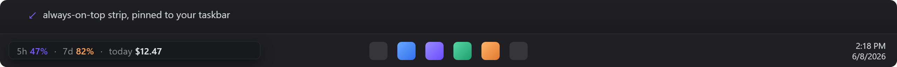
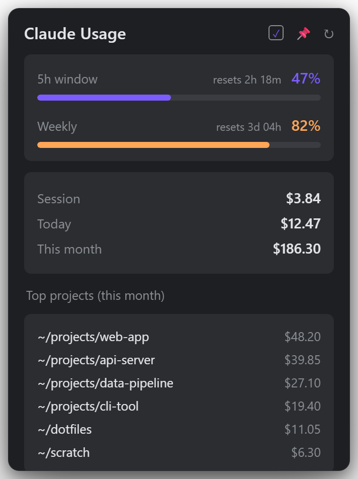
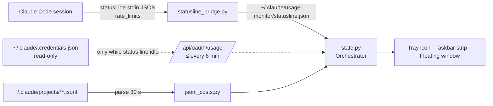

<div align="center">

# ClaudeUsageMonitor

### A featherweight Windows tray app that shows your real Claude Code Pro/Max quota live — read straight from Claude Code's own status line, so there is nothing to log into and no token to manage.

**English** · **[中文](README.zh.md)**

[](LICENSE)
[](#requirements)
[](https://www.python.org/)
[](https://github.com/Cohenjikan/ClaudeUsageMoniter/stargazers)

**Your Claude quota, always on the taskbar. Zero extra logins.**



</div>

---

<div align="center">



*Live demo. [Watch the full promo →](screenshots/promo.mp4)*

</div>

---

## Why you'll want this

You live in Claude Code all day. You keep hitting the 5-hour wall or the weekly cap and finding out *only when Claude tells you*. Existing monitors either look like a broken spreadsheet, make you re-login through a browser every few hours, or only count your local logs and never show the real server quota.

**ClaudeUsageMonitor pins the authoritative numbers to your taskbar and stays out of your way.** Claude Code already knows your 5-hour and weekly utilization and hands it to its status-line command; this app captures that, and shows you exactly how close you are to the limit — before you slam into it.

> **The trick:** since v2.1.80 Claude Code pipes a `rate_limits` block to your [status line](https://code.claude.com/docs/en/statusline) command. A tiny bridge captures it to a local file and the tray app watches that file. **No token is read, refreshed or sent, and there is no network request** — so no rate limit either. While Claude Code is idle, an optional **read-only** call to the usage endpoint fills the gap.

---

## What you get

Benefit first, mechanism second. Everything below is wired to real code in this repo.

### Token-free, live quota from Claude Code's status line
Your 5-hour and weekly numbers update every time Claude Code refreshes its status line — no polling interval, no login, no token handling.
> `statusline_bridge.py` is registered as Claude Code's `statusLine` command (one checkbox in **Settings → General**). It saves only the payload's `rate_limits` block (plus the model name) to `~/.claude/usage-monitor/statusline.json` and prints a status line. If you already had a status line, the bridge **chains** it — your existing command still runs and its output is what you see. `Orchestrator.poll_statusline` (`state.py`) stats that file every 2 s and publishes new data immediately.

### Real server-side quota, not an estimate
The 5-hour and weekly percentages are the *same authoritative numbers Claude Code uses*, and they include **all** of your subscription usage — Code **plus** chat/desktop/web — not a guess from local logs.
> Both sources carry Anthropic's own utilization figures. They are normalized into one shape (`statusline.body_from_capture` → `usage_api.snapshot_from_body`), so the UI, alerts and cache treat them identically.

### Read-only fallback while Claude Code is idle
When no Claude Code session is running (say, a chat-only afternoon), the app can still keep the quota current.
> `fetch_usage` (`usage_api.py`) GETs the undocumented `https://api.anthropic.com/api/oauth/usage` endpoint with the access token Claude Code currently has on disk. It runs every 6 min only while the status line is idle, drops to every 30 min while it is live (just to pick up model-scoped buckets), and can be turned off entirely in **Settings → General**.

### Never touches your login
This app **never refreshes or writes your OAuth token**. The `refresh_token` in `~/.claude/.credentials.json` is shared with Claude Code and rotates on every use, so refreshing it from a second program can race Claude Code and log you out; it would also mean impersonating Claude Code's OAuth client.
> `usage_api.py` contains no refresh or write code at all (a unit test asserts it). If the on-disk access token is expired or rejected, the API fallback just waits — re-reading the file every 45 s, no network — and recovers the moment Claude Code rotates it. With the status-line source on, an expired token doesn't matter in the first place.

### Always-visible taskbar strip
A tiny borderless readout sits right on the Windows taskbar, so your quota is glanceable without opening anything.



> `TaskbarStrip` (`app.py:515+`) is a borderless `overrideredirect` `Toplevel` with a nominal `STRIP_W, STRIP_H = 360, 26`, pinned inside the taskbar band via `get_strip_default_y`. Its width auto-grows to fit the rendered text each tick — it is not a fixed-width bar.

### Stays on top of the Win11 shell
The strip doesn't get buried by maximized windows, the taskbar, or autostart races at boot.
> Three defenses in `app.py`: a per-tick topmost bump (`_force_topmost`), a direct `SetWindowPos(HWND_TOPMOST)` backup (`_force_topmost_winapi`), and `WindowFromPoint` multi-point coverage detection (`_is_covered`) — plus a startup bump burst from 300 ms to 10 s.
>
> **Experimental: embed inside the taskbar.** **Settings → Strip → Embed inside the taskbar** turns the strip into a child window of the taskbar (`Shell_TrayWnd`), the approach TrafficMonitor uses on Win11. A child of the taskbar is drawn as part of it, so nothing can cover it and none of the topmost machinery runs. It relies on undocumented shell internals, so it is off by default; if embedding fails (shell not up yet, blocked by security software) the strip stays in topmost mode and retries every ~5 s, and an `explorer.exe` restart is healed automatically (`TaskbarStrip._try_embed` / `_embed_healthy`). Drag mode is disabled while embedded.

### Drag-to-place, position persists
Put the strip wherever you like; it stays there across restarts.
> Move-strip drag mode saves x/y to a per-user `config.json` next to the script on mouse release (`_on_btn1_release`); on the next launch the strip restores that saved position. `reset_position` snaps it back to defaults.

### Per-project / today / month / session cost
See which projects burn the most equivalent-API dollars, plus running today/month totals — handy for comparing project value.
> `jsonl_costs.py` parses `~/.claude/projects/**/*.jsonl` (`iter_turns`) and aggregates into `by_project`, `by_session`, `today`, `this_month` (`build_report`). Day/month boundaries use your **local** timezone.
> **De-duplication (important for accuracy):** Claude Code writes a separate JSONL line for every content block of an assistant message (thinking, text, and each `tool_use`), and they all carry the **same** `message.id`, `requestId`, and `usage` object. Counting every line over-counts cost massively — on real data ~62% of usage lines are such duplicates, inflating totals ~4–5×. `iter_turns` counts each `(message.id, requestId)` exactly once (same approach as `ccusage`). The de-dup set is global across files, which also collapses history duplicated into resumed/forked sessions.

### Two-tier cache pricing
Cost estimates respect Anthropic's split cache-creation pricing, so the equivalent-$ figure is closer to reality.
> `PRICING` (`jsonl_costs.py:21`) holds separate `cache_5m` and `cache_1h` rates per model; `_parse_turn` reads `ephemeral_5m_input_tokens` and `ephemeral_1h_input_tokens` and prices them independently.

### Native threshold toasts at 75 / 90 / 95%
Windows pops a notification before you hit the wall, with escalating wording as you approach the limit.
> `Orchestrator.THRESHOLDS = (75, 90, 95)` (`state.py:76`); `_check_thresholds` fires once per crossing and re-arms when usage drops below; `notify()` sends a `winotify` toast whose body escalates at 90% and 95%.

### Per-model weekly quotas (Fable and friends)
Anthropic now meters some models against their own weekly bucket on top of the overall weekly limit. Each one gets its own row, bar, and reset countdown — so a model-specific limit can't sneak up on you while the overall weekly number still looks healthy.
> The usage endpoint returns these as `kind: "weekly_scoped"` entries in a `limits` array, carrying `scope.model.display_name` (e.g. `Fable`), `percent`, `severity`, and their own `resets_at`. `_parse_scoped_limits` (`usage_api.py`) reads them **generically** — a new model bucket shows up with no code change — deduping by name and folding in the legacy `seven_day_opus` / `seven_day_sonnet` fields when a response still carries them. Threshold alerts fire per bucket.

### Full-detail floating window
Click the strip or tray for a dark, borderless card with quota bars, reset countdowns, cost rollups, and a top-projects list.



> `FloatingWindow` renders color-coded 5h/7d pill bars plus one row per model-scoped weekly bucket, absolute reset times with live countdowns (repaints every 1 s), session/today/month costs, and up to 6 top-project rows. The projects panel is **scoped to the current month** (`by_project_month`). The window is borderless (`overrideredirect`) with a custom draggable title bar and Win11 DWM rounded corners; its width is pinned while the height follows content. Hidden by default.

### Tray icon shows live 5h%
Even with no windows open, the system-tray badge tells you your 5-hour usage at a glance, color-coded by severity.
> `render_tray_icon` (`app.py:282`) draws the integer 5h% on a rounded rect colored by `color_for_pct` (green / orange / red), updated on every state change.

### Bilingual UI and a real Settings window
Switch between English and Chinese, toggle autostart, and choose strip side / opacity / display mode — all from one **tray → Settings** window (General / Strip / About), not buried tray submenus.
> `LANGUAGES` holds `en` and `zh` dicts driving every visible string; `SettingsWindow` (`app.py`) is a dark-themed `Toplevel` with a custom segmented tab bar. It offers the language picker, the **Run at startup** checkbox, the quota-source switches (status line / read-only API fallback) with a live status label, strip side (left/right), opaque background, taskbar embedding, and four display modes (compact / +time-remaining / +time-remaining% / +time-elapsed%). Live changes apply immediately and persist to `config.json`.

### Boots instantly, never silently freezes
The window shows your last-known quota the moment it opens — even before the first network call — and only one copy ever runs. If the data pipeline ever stalls (expired token, dead network), the quota is greyed and marked **stale** with its age, so it reads as *old data*, never as a frozen app.
> A single-instance named mutex makes a second launch exit quietly (`main()`). The last good snapshot is cached to `usage_cache.json` and seeded on startup, with a fast-retry ladder so fresh numbers land quickly once connectivity clears. Both repaint loops reschedule in `finally` (an exception can't kill the chain), every Settings PowerShell call runs off the main thread, and a rotating file log (`cc-usage-tray.log`) captures diagnostics that `pythonw.exe` would otherwise discard.

---

## Quickstart

**Prerequisites:** Windows 10/11 · Claude Code installed and logged in with a Pro/Max plan.

### Option A — download the exe (no Python needed)

1. Grab `ClaudeUsageMonitor-win64.zip` from the [latest release](https://github.com/Cohenjikan/ClaudeUsageMoniter/releases/latest) and unzip it anywhere you can write to (e.g. `D:\Apps\ClaudeUsageMonitor`). Settings and the cache are stored next to the exe.
2. Run `ClaudeUsageMonitor.exe`.

### Option B — run from source (Python 3.11+)

```powershell
git clone https://github.com/Cohenjikan/ClaudeUsageMoniter D:\Apps\cc-usage-tray
cd D:\Apps\cc-usage-tray
pip install -r requirements.txt     # tkinter ships with Python
pythonw.exe app.py                  # pythonw = no console window
```

### Turn on the status-line source (recommended)

Open **tray → Settings → General** and tick **Claude Code status line**. This adds a `statusLine` entry to `~/.claude/settings.json` (a backup is saved as `settings.json.bak-usage-monitor`; an existing status line keeps working through the bridge). Unticking it restores your previous status line. The status label under the checkbox shows whether a Claude Code session is feeding live data.

Without it the app still works, using only the read-only API fallback.

### Optional: launch at startup

Open **tray → Settings → General** and tick **Run at startup**. It creates (and removes) a Startup-folder shortcut to the exe, or to `app.py` via `pythonw.exe` when running from source.

---

## How the quota data flows

**Primary — the Claude Code status line.** Claude Code runs your `statusLine` command on every status refresh and pipes it a JSON payload. On Pro/Max plans it includes:

```json
"rate_limits": {
  "five_hour": {"used_percentage": 33, "resets_at": 1767225600},
  "seven_day": {"used_percentage": 91, "resets_at": 1767600000}
}
```

`statusline_bridge.py` (or `cc-usage-statusline.exe` in the release zip) writes that block to `~/.claude/usage-monitor/statusline.json` and prints a status line. The tray app picks up the change within ~2 s.

**Fallback — a read-only usage-endpoint call.** While the status line is idle, the app calls the undocumented `https://api.anthropic.com/api/oauth/usage` with Claude Code's current access token (`anthropic-beta: oauth-2025-04-20`, `User-Agent: claude-code/2.0.0`, without which you land in a tighter rate-limit bucket). It never refreshes the token. The endpoint allows only ~5 requests per token, hence 6-minute polling, slowed to 30 minutes while the status line is live.

**Local costs.** `~/.claude/projects/**/*.jsonl` is parsed every 30 s.



---

## Why this exists

Off-the-shelf options each had a deal-breaker. (The auth/UI mechanism of *this* project is verified from the code here; the assessments of the other tools are the author's own.)

| Tool | Auth | UI | Showstopper (author's take) |
|---|---|---|---|
| [CodeZeno/Claude-Code-Usage-Monitor](https://github.com/CodeZeno/Claude-Code-Usage-Monitor) | Piggybacks Claude Code OAuth | Pixelated colored blocks | Ugly UI |
| [SlavomirDurej/claude-usage-widget](https://github.com/SlavomirDurej/claude-usage-widget) | Claude.ai web session | Electron widget | Periodic browser re-login |
| [ryoppippi/ccusage](https://github.com/ryoppippi/ccusage) | Local JSONL only | CLI / statusline | No GUI · no real server quota |
| **ClaudeUsageMonitor** | **Claude Code status line** (+ read-only OAuth fallback) | **Tray + strip + window** | **Windows-only** |

This project takes what it wanted from all three: **zero login** (status line first, read-only OAuth fallback) + a **clean tkinter UI** + **real server-side quota %** + **per-project cost** from local JSONL. It pins inside the Win11 taskbar band with a 3-mechanism topmost defense, so maximized windows structurally can't cover it — a problem most floating widgets ignore.

---

## Honest caveats (trust is a feature)

Read these before you rely on the numbers. They are deliberate, not bugs.

- **The `$` figures are Claude Code (CLI) only.** Today / session / month / per-project dollars come **purely** from local `~/.claude/projects` transcripts. The Claude **desktop app and web chat write no local token counts**, so on a chat-only day **"Today $" stays $0.00**. The 5h/7d **percent** bars are different — those come from the server and **do** include chat + code together. That's the number to watch if you mix the two.
- **Equivalent-API $ is for comparison, not billing.** You pay a flat Pro/Max subscription. These dollars estimate what the same tokens would cost on the pay-as-you-go API — useful for ranking project value, not for your invoice.
- **Live updates need a running Claude Code session.** The status-line source only updates while Claude Code is open and refreshing its status line. Otherwise the read-only API fallback updates at most every 6 minutes (the endpoint is aggressively rate-limited), and if you've turned the fallback off the quota is marked stale after 15 minutes. Local JSONL cost refreshes every 30 s.
- **The strip defaults to your primary monitor.** A dragged position can land on a secondary monitor; **Reset strip position** returns it to primary.
- **Exclusive-fullscreen games/apps render above everything in user space**, so the strip is hidden while one is in front. Use borderless-windowed mode to keep it visible.
- **Windows 10/11 only.** Despite the credentials path existing on macOS/Linux, the entire UI is Windows-specific (ctypes/user32, taskbar pinning, `winotify` toasts, a PowerShell-path fix for toast delivery). It is **not** cross-platform.
- **Requires Claude Code on a Pro/Max plan.** The app has no login of its own. API-key accounts get no `rate_limits` in the status line and have no subscription quota to show.
- **Quota goes *stale*, never wrong.** If no source can produce fresh data (Claude Code idle and its access token expired, network down, fallback switched off), the quota is clearly **greyed and marked stale with its age**. The app never refreshes the token itself; opening Claude Code rotates it and the quota recovers on its own.
- **The fallback uses an undocumented endpoint and a Claude Code User-Agent.** That part is not an official or supported Anthropic integration and could break at any time. Anthropic's terms restrict using subscription OAuth tokens in third-party tools; this app only reads usage figures and never sends inference requests, but if you'd rather not touch the token at all, untick **Fallback: read-only usage API** and rely on the status line alone.
- **Taskbar embedding is experimental.** It depends on undocumented Windows shell internals and may misbehave on some Windows builds; it's off by default.

---

## Architecture

```
statusline_bridge.py  Claude Code statusLine command: captures rate_limits, chains
                      any previous status line, always exits 0.
statusline.py         Capture format, conversion to the usage-body shape, and
                      install/uninstall of the bridge in ~/.claude/settings.json.
usage_api.py          READ-ONLY OAuth token loader + /api/oauth/usage client.
jsonl_costs.py        JSONL parser + cost aggregator (two-tier cache pricing).
state.py              Orchestrator: statusline watcher (2 s), throttled read-only
                      API fallback, JSONL parse (30 s), threshold alerts, cache.
paths.py              Where runtime files live (next to app.py, or the exe).
app.py                Entry point: tkinter FloatingWindow + pystray tray icon +
                      TaskbarStrip (topmost mode or experimental taskbar embed).
ClaudeUsageMonitor.spec  PyInstaller one-folder build (tray exe + helper exe).
```

---

## Configuration

Most behavior is constants at the top of `app.py`:

```python
WINDOW_W = 360                    # floating window width (height follows content)
STRIP_W, STRIP_H = 360, 26        # taskbar strip nominal size (width auto-grows to fit text)
STRIP_SIDE = "left"               # "left" or "right" — which screen edge
STRIP_SIDE_MARGIN = 12            # gap from chosen edge
STRIP_GAP_FROM_TASKBAR = 0        # gap between strip bottom and taskbar top
```

Per-user state (strip position, side, display mode, opaque-background and embed toggles, language, and the `quota.api_fallback` switch) lives in a `config.json` next to `app.py` (or next to the exe) — set it by dragging and via **tray → Settings**. The file is per-user and git-ignored, so a fresh clone has none until you create one; delete it or use **Reset position** (Settings → Strip) to snap back to defaults.

The pricing table is `jsonl_costs.py:PRICING` — update it when Anthropic adjusts rates or ships new model families.

---

## Requirements

| | |
|---|---|
| **OS** | Windows 10 or 11 |
| **Python** | none for the release exe; 3.11+ to run from source |
| **Dependencies** | `pystray`, `Pillow`, `winotify` (tkinter ships with Python) — see `requirements.txt` |
| **Prerequisite** | Claude Code installed and logged in on a Pro/Max plan (v2.1.80+ for the status-line source) |

---

## Development

```powershell
python -m unittest discover -s tests   # stdlib only; also runs on Linux/macOS
.\build.ps1                            # tests + PyInstaller build into dist\ClaudeUsageMonitor\
```

CI (`.github/workflows/build.yml`) runs the tests on Windows, builds the one-folder package, smoke-tests the status-line helper exe, and attaches `ClaudeUsageMonitor-win64.zip` to the GitHub Release when a `v*` tag is pushed.

---

## License

[MIT](LICENSE) © 2026 Cohenjikan.

This is an unofficial, community-built tool. It is not affiliated with, endorsed by, or supported by Anthropic. "Claude" and "Claude Code" are trademarks of Anthropic. The `/api/oauth/usage` endpoint is undocumented; use at your own discretion.

---

<div align="center">

**If this saves you from one rate-limit surprise, consider giving it a star.**

[Report an issue](https://github.com/Cohenjikan/ClaudeUsageMoniter/issues) · [Repo](https://github.com/Cohenjikan/ClaudeUsageMoniter)

</div>
