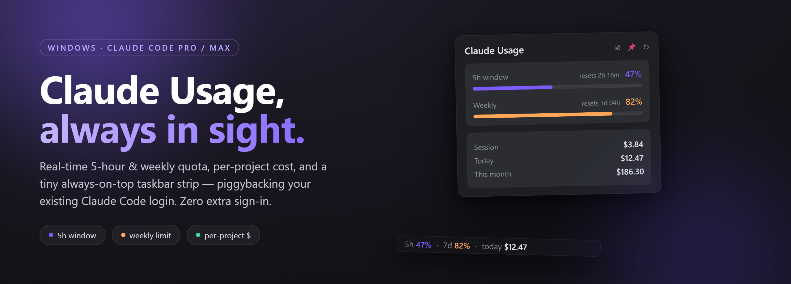
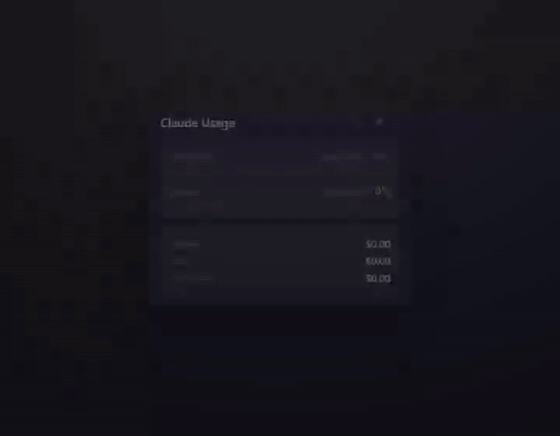
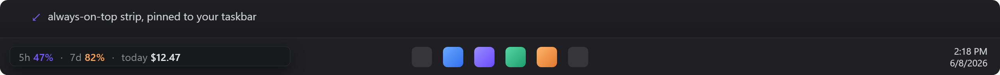
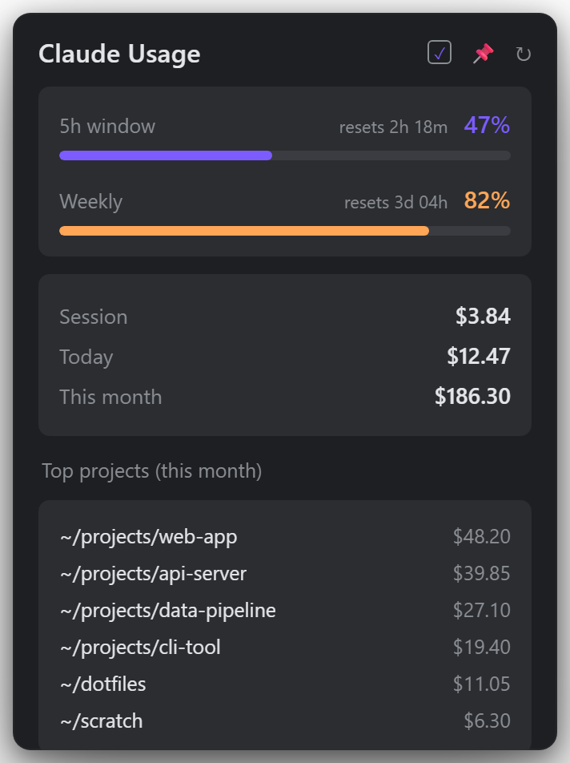
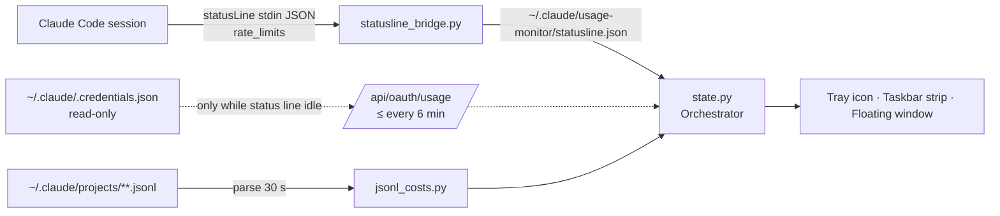

<div align="center">

# ClaudeUsageMonitor

### 一款超轻量的 Windows 托盘应用，实时显示你的 Claude Code Pro/Max 真实配额——数据直接来自 Claude Code 自己的状态栏，无需登录，也不碰任何 token。

**[English](README.md)** · **中文**

[](LICENSE)
[](#环境要求)
[](https://www.python.org/)
[](https://github.com/Cohenjikan/ClaudeUsageMoniter/stargazers)

**让你的 Claude 配额常驻任务栏，零额外登录。**



</div>

---

<div align="center">



*实时演示。[观看完整宣传片 →](screenshots/promo.mp4)*

</div>

---

## 为什么你会想要它

你每天大量使用 Claude Code，却总是撞上 5 小时上限或每周封顶——而且往往是*等到 Claude 提示你时才知道*。现有的监控工具要么界面像坏掉的电子表格，要么每隔几小时就逼你重新过一遍浏览器登录，要么只统计本地日志、从不显示真实的服务端配额。

**ClaudeUsageMonitor 把权威数字钉在你的任务栏上，又绝不碍事。** Claude Code 本来就知道你的 5 小时和每周用量，并会把它传给状态栏命令；本应用把这份数据接过来，准确告诉你离上限还有多远——在你触顶之前。

> **诀窍所在：** 从 v2.1.80 起，Claude Code 会把 `rate_limits` 数据通过 stdin 传给你的[状态栏](https://code.claude.com/docs/en/statusline)命令。一个很小的桥接脚本把它存到本地文件，托盘程序监听这个文件。**不读取、不刷新、不发送任何 token，也没有网络请求**——所以也没有限流。Claude Code 空闲时，可选的**只读** API 调用负责补位。

---

## 你能获得什么

收益在前，机制在后。以下每一项都对应着本仓库中真实的代码。

### 无需 token 的实时配额（来自 Claude Code 状态栏）
每次 Claude Code 刷新状态栏，你的 5 小时与每周数字就跟着更新——没有轮询间隔，不用登录，不碰 token。
> `statusline_bridge.py` 注册为 Claude Code 的 `statusLine` 命令（**设置 → 常规**里勾选一下即可）。它只把数据里的 `rate_limits`（外加模型名）存到 `~/.claude/usage-monitor/statusline.json`，并输出一行状态栏文字。如果你原本就有状态栏，桥接脚本会**串联**执行它——你原来的命令照常运行，显示的也还是它的输出。`Orchestrator.poll_statusline`（`state.py`）每 2 秒检查一次该文件，有新数据立即发布。

### 真实服务端配额，而非估算
5 小时与每周百分比就是 *Claude Code 所使用的同一份权威数字*，并且涵盖你**全部**订阅用量——Code **加上** chat/desktop/web——而不是从本地日志猜出来的。
> 两个数据源携带的都是 Anthropic 自己的用量数字。它们被统一转换成同一种结构（`statusline.body_from_capture` → `usage_api.snapshot_from_body`），因此界面、提醒和缓存对两者一视同仁。

### Claude Code 空闲时的只读后备
没有 Claude Code 会话在运行时（比如一下午只用 chat），配额仍然可以保持更新。
> `fetch_usage`（`usage_api.py`）用 Claude Code 当前磁盘上的 access token，向未公开文档的 `https://api.anthropic.com/api/oauth/usage` 发起 GET。只有状态栏空闲时才每 6 分钟调用一次；状态栏活跃时降到每 30 分钟一次（仅为获取分模型配额）；也可以在**设置 → 常规**里完全关闭。

### 绝不碰你的登录状态
本应用**从不刷新、也从不写入你的 OAuth 令牌**。`~/.claude/.credentials.json` 里的 `refresh_token` 与 Claude Code 共用，且每用一次就轮换；由第二个程序去刷新，可能与 Claude Code 抢写导致你被登出，而且等于冒充 Claude Code 的 OAuth 客户端。
> `usage_api.py` 中完全没有刷新或写入代码（有单元测试保证）。磁盘上的 access token 过期或被拒时，API 后备只会等待——每 45 秒重新读一次文件，不发网络请求——Claude Code 一轮换令牌就自动恢复。开启状态栏数据源后，token 过期本身就无关紧要。

### 始终可见的任务栏条
一条极小的无边框读数条直接停靠在 Windows 任务栏上，无需打开任何窗口即可一瞥配额。



> `TaskbarStrip`（`app.py:515+`）是一个无边框的 `overrideredirect` `Toplevel`，标称尺寸为 `STRIP_W, STRIP_H = 360, 26`，通过 `get_strip_default_y` 钉在任务栏区域内。它的宽度会在每个刷新周期自动伸缩以容纳渲染出的文字——并非固定宽度的条。

### 稳压 Win11 外壳之上
任务栏条不会被最大化窗口、任务栏或开机时的自启动竞争所遮挡。
> `app.py` 中有三道防线：每周期的置顶补偿（`_force_topmost`）、直接的 `SetWindowPos(HWND_TOPMOST)` 兜底（`_force_topmost_winapi`），以及基于 `WindowFromPoint` 的多点遮挡检测（`_is_covered`）——外加一段从 300 毫秒持续到 10 秒的启动置顶补偿连击。
>
> **实验性：嵌入任务栏内部。** **设置 → 状态条 → 嵌入任务栏内部**会把状态条变成任务栏（`Shell_TrayWnd`）的子窗口，也就是 TrafficMonitor 在 Win11 上的做法。任务栏的子窗口作为任务栏的一部分绘制，任何窗口都盖不住它，上面那套置顶机制也完全不用运行。它依赖未公开的系统外壳细节，所以默认关闭；嵌入失败时（外壳还没启动、被安全软件拦截）状态条保持置顶模式并每约 5 秒重试，`explorer.exe` 重启后也会自动恢复（`TaskbarStrip._try_embed` / `_embed_healthy`）。嵌入状态下不能拖动。

### 拖拽定位，位置持久化
把它放到你喜欢的任何位置；重启后依旧停在那里。
> 移动模式下，在松开鼠标时把 x/y 坐标保存到脚本同目录、按用户区分的 `config.json`（`_on_btn1_release`）；下次启动时任务栏条会恢复到该保存位置。`reset_position` 可将其复位到默认位置。

### 按项目／今日／本月／会话的花费
看清哪些项目烧掉了最多的等效 API 费用，再配上今日／本月的累计——便于对比各项目的价值。
> `jsonl_costs.py` 解析 `~/.claude/projects/**/*.jsonl`（`iter_turns`），并聚合成 `by_project`、`by_session`、`today`、`this_month`（`build_report`）。日／月的边界以你的**本地**时区为准。

### 两档缓存定价
费用估算遵循 Anthropic 拆分的缓存创建定价，因此等效美元数字更贴近实际。
> `PRICING`（`jsonl_costs.py:21`）为每个模型分别保存 `cache_5m` 与 `cache_1h` 费率；`_parse_turn` 读取 `ephemeral_5m_input_tokens` 与 `ephemeral_1h_input_tokens`，并独立计价。

### 75 / 90 / 95% 原生阈值提醒
在你撞上上限之前，Windows 会弹出通知，措辞随着你逼近上限而逐级升级。
> `Orchestrator.THRESHOLDS = (75, 90, 95)`（`state.py:76`）；`_check_thresholds` 在每次越过阈值时触发一次，并在用量回落后重新就绪；`notify()` 发送 `winotify` 通知，其正文在 90% 与 95% 时逐级升级。

### 分模型周配额（Fable 等）
Anthropic 现在会对部分模型在总周配额之外单独计量。每个这类配额都有自己的一行、进度条与重置倒计时——总周配额看着还宽裕时，模型专属的上限也不会悄悄逼近而你毫无察觉。

> 用量接口把它们放在 `limits` 数组里，形如 `kind: "weekly_scoped"`，带有 `scope.model.display_name`（例如 `Fable`）、`percent`、`severity` 以及各自的 `resets_at`。`_parse_scoped_limits`（`usage_api.py`）**通用解析**——将来新增模型配额无需改代码即可显示——按名称去重，并在响应仍携带旧字段时兼容折叠 `seven_day_opus` / `seven_day_sonnet`。阈值告警按配额分别触发。

### 完整详情悬浮窗
点击任务栏条或托盘图标，即可打开一张深色无边框卡片，内含配额进度条、重置倒计时、花费汇总以及高消耗项目列表。



> `FloatingWindow` 渲染分色的 5h/7d 胶囊进度条，以及每个分模型周配额各占一行、绝对重置时刻配实时倒计时（每 1 秒重绘）、会话／今日／本月花费，以及最多 6 行高消耗项目。项目面板**仅统计当月**（`by_project_month`）。窗口为无边框（`overrideredirect`），配自绘可拖动标题栏与 Win11 DWM 圆角；宽度锁定，高度随内容自适应。默认隐藏。

### 托盘图标实时显示 5h%
即便没有打开任何窗口，系统托盘徽标也能让你一眼看到 5 小时用量，并按严重程度分色。
> `render_tray_icon`（`app.py:282`）在一个圆角矩形上绘制 5h% 整数值，颜色由 `color_for_pct` 决定（绿／橙／红），并在每次状态变化时更新。

### 双语界面与真正的设置窗口
在中英文之间切换、开关开机自启、选择状态条靠边／不透明度／显示模式——全都在同一个**托盘 → 设置**窗口里完成（常规／状态条／关于），不再是层层嵌套的托盘子菜单。
> `LANGUAGES` 保存 `en` 与 `zh` 两套字典，驱动每一处可见文案；`SettingsWindow`（`app.py`）是一个深色主题的 `Toplevel`，配有自绘的分段式标签栏。它提供语言选择器、**开机自启**复选框、配额数据来源开关（状态栏 / 只读 API 后备）及实时状态提示、状态条靠边（左／右）、不透明背景、嵌入任务栏，以及四种显示模式（紧凑 / +剩余时间 / +剩余时间% / +已用时间%）。所有更改即时生效并持久化到 `config.json`。

### 秒开，且绝不会无声卡死
窗口一打开就显示你最近一次已知的配额——哪怕首次网络请求还没回来——而且全程只会运行一个实例。万一数据管线停摆（令牌过期、断网），配额会被置灰并标上**「数据旧」**及其时长，让它读起来是*旧数据*，而不是一个卡死的程序。
> 单实例命名互斥量让第二次启动安静退出（`main()`）。最近一次成功的快照会缓存到 `usage_cache.json` 并在启动时载入，再配以快速重试阶梯，网络一恢复就尽快拿到最新数字。两个重绘循环都在 `finally` 里重新排程（异常杀不掉刷新链），每一次设置面板的 PowerShell 调用都在主线程之外运行，并有一个滚动文件日志（`cc-usage-tray.log`）记录 `pythonw.exe` 否则会丢弃的诊断信息。

---

## 快速上手

**前置条件：** Windows 10/11 · 已安装 Claude Code 并用 Pro/Max 账号登录。

### 方式 A：下载 exe（不需要 Python）

1. 从[最新 Release](https://github.com/Cohenjikan/ClaudeUsageMoniter/releases/latest) 下载 `ClaudeUsageMonitor-win64.zip`，解压到任意有写权限的目录（例如 `D:\Apps\ClaudeUsageMonitor`）。设置和缓存都保存在 exe 旁边。
2. 运行 `ClaudeUsageMonitor.exe`。

### 方式 B：从源码运行（Python 3.11+）

```powershell
git clone https://github.com/Cohenjikan/ClaudeUsageMoniter D:\Apps\cc-usage-tray
cd D:\Apps\cc-usage-tray
pip install -r requirements.txt     # tkinter 随 Python 一同提供
pythonw.exe app.py                  # pythonw = 无控制台窗口
```

### 开启状态栏数据源（推荐）

打开**托盘 → 设置 → 常规**，勾选 **Claude Code 状态栏**。这会在 `~/.claude/settings.json` 里添加一条 `statusLine`（原文件备份为 `settings.json.bak-usage-monitor`；你原有的状态栏会通过桥接照常显示）。取消勾选即恢复原来的状态栏。复选框下方的状态提示会显示当前是否有 Claude Code 会话在提供实时数据。

不开启也能用，只是只剩只读 API 后备这一个数据源。

### 可选：开机自启动

打开**托盘 → 设置 → 常规**，勾选**开机自启**。它会在启动文件夹中创建（或删除）指向 exe 的快捷方式；从源码运行时则通过 `pythonw.exe` 启动 `app.py`。

---

## 配额数据从哪里来

**主数据源：Claude Code 状态栏。** Claude Code 每次刷新状态栏都会运行你的 `statusLine` 命令，并通过 stdin 传入一段 JSON。Pro/Max 账号的数据里包含：

```json
"rate_limits": {
  "five_hour": {"used_percentage": 33, "resets_at": 1767225600},
  "seven_day": {"used_percentage": 91, "resets_at": 1767600000}
}
```

`statusline_bridge.py`（Release 压缩包里是 `cc-usage-statusline.exe`）把这段数据写入 `~/.claude/usage-monitor/statusline.json` 并输出一行状态栏文字。托盘程序约 2 秒内就能拿到变化。

**后备：只读调用用量接口。** 状态栏空闲时，程序用 Claude Code 当前的 access token 调用未公开文档的 `https://api.anthropic.com/api/oauth/usage`（带 `anthropic-beta: oauth-2025-04-20` 和 `User-Agent: claude-code/2.0.0`，缺少后者会被归入更严格的限流桶）。它从不刷新 token。该接口每个 token 只允许约 5 次请求，所以每 6 分钟轮询一次；状态栏活跃时放慢到每 30 分钟。

**本地花费。** 每 30 秒解析一次 `~/.claude/projects/**/*.jsonl`。



---

## 为什么要做这个项目

现成的方案各有一处让人无法接受的硬伤。（*本*项目的认证／UI 机制均依据此处的代码验证；对其它工具的评价为作者一家之言。）

| 工具 | 认证方式 | 界面 | 致命伤（作者观点） |
|---|---|---|---|
| [CodeZeno/Claude-Code-Usage-Monitor](https://github.com/CodeZeno/Claude-Code-Usage-Monitor) | 借用 Claude Code OAuth | 像素化的彩色方块 | 界面丑 |
| [SlavomirDurej/claude-usage-widget](https://github.com/SlavomirDurej/claude-usage-widget) | Claude.ai 网页会话 | Electron 小部件 | 周期性的浏览器重新登录 |
| [ryoppippi/ccusage](https://github.com/ryoppippi/ccusage) | 仅本地 JSONL | CLI / statusline | 无 GUI · 无真实服务端配额 |
| **ClaudeUsageMonitor** | **Claude Code 状态栏**（+ 只读 OAuth 后备） | **托盘 + 任务栏条 + 窗口** | **仅限 Windows** |

本项目从这三者中各取所长：**零登录**（状态栏优先，只读 OAuth 后备）+ **干净的 tkinter 界面** + **真实的服务端配额 %** + 来自本地 JSONL 的**按项目花费**。它嵌在 Win11 任务栏区域内，配以三重置顶防御，使最大化窗口在结构上无法将其遮挡——这正是大多数悬浮小部件忽视的问题。

---

## 诚实的注意事项（可信本身就是一项特性）

在你依赖这些数字之前，请先读完它们。它们是有意为之，而非缺陷。

- **`$` 金额仅涵盖 Claude Code（CLI）。** 今日／会话／本月／按项目的美元数**纯粹**来自本地 `~/.claude/projects` 的会话记录。Claude **桌面应用与网页 chat 不会写入任何本地 token 计数**，因此在只用 chat 的日子里，**「今日 $」会停留在 $0.00**。 5h/7d 的**百分比**进度条则不同——它们来自服务端，**确实**把 chat 与 code 一并计入。如果你两者混用，这才是该盯紧的数字。
- **等效 API $ 仅供对比，不用于计费。** 你支付的是固定的 Pro/Max 订阅费。这些美元估算的是同样的 token 在按量付费 API 上会花多少钱——用于给项目价值排序很有用，但不对应你的账单。
- **实时更新需要有 Claude Code 会话在运行。** 状态栏数据源只在 Claude Code 打开并刷新状态栏时更新。其余时间由只读 API 后备最多每 6 分钟更新一次（该接口限流严格）；如果你关闭了后备，配额会在 15 分钟后标记为「数据旧」。本地 JSONL 花费每 30 秒刷新一次。
- **任务栏条默认显示在主显示器上。** 拖动后的位置可能落到副显示器上；**重置任务栏条位置**会让它回到主显示器。
- **独占全屏的游戏／应用会渲染在用户空间一切之上**，因此当某个这样的程序在前台时任务栏条会被遮住。请改用无边框窗口模式以保持其可见。
- **仅限 Windows 10/11。** 尽管凭据路径在 macOS/Linux 上同样存在，整套 UI 都是 Windows 专属的（ctypes/user32、任务栏钉附、`winotify` 通知，以及一处用于通知投递的 PowerShell 路径修复）。它**不是**跨平台的。
- **需要 Pro/Max 账号的 Claude Code。** 本应用自身没有任何登录功能。API key 账号的状态栏数据里没有 `rate_limits`，也没有订阅配额可显示。
- **配额只会「变旧」，绝不会变错。** 如果所有数据源都拿不到新数据（Claude Code 空闲且 access token 已过期、断网、关闭了后备），配额会被清楚地**置灰并标上「数据旧」及其时长**。本应用从不自己刷新 token；打开 Claude Code 让它轮换令牌，配额就会自动恢复。
- **后备数据源使用未公开的接口和 Claude Code 的 User-Agent。** 这部分不是 Anthropic 官方或受支持的集成，随时可能失效。Anthropic 的条款限制在第三方工具中使用订阅 OAuth 令牌；本应用只读取用量数字、从不发送推理请求，但如果你完全不想碰 token，可以取消勾选**后备：只读调用用量 API**，只依赖状态栏。
- **嵌入任务栏是实验性功能。** 它依赖未公开的 Windows 外壳细节，在部分 Windows 版本上可能表现异常，默认关闭。

---

## 架构

```
statusline_bridge.py  Claude Code 的 statusLine 命令：保存 rate_limits，串联执行
                      原有状态栏，永远以 0 退出。
statusline.py         数据格式、转换为用量接口结构，以及在
                      ~/.claude/settings.json 中安装/卸载桥接。
usage_api.py          只读的 OAuth 令牌读取 + /api/oauth/usage 客户端。
jsonl_costs.py        JSONL 解析器 + 花费聚合器（两档缓存定价）。
state.py              Orchestrator：状态栏文件监听（2 秒）、节流的只读 API 后备、
                      JSONL 解析（30 秒）、阈值提醒、缓存。
paths.py              运行时文件位置（app.py 或 exe 所在目录）。
app.py                入口：tkinter FloatingWindow + pystray 托盘图标 +
                      TaskbarStrip（置顶模式或实验性的任务栏嵌入）。
ClaudeUsageMonitor.spec  PyInstaller 单目录构建（托盘 exe + 状态栏辅助 exe）。
```

---

## 配置

大多数行为是 `app.py` 顶部的常量：

```python
WINDOW_W = 360                    # 悬浮窗口宽度（高度随内容自适应）
STRIP_W, STRIP_H = 360, 26        # 任务栏条标称尺寸（宽度会自动伸缩以容纳文字）
STRIP_SIDE = "left"               # "left" 或 "right"——靠哪一侧屏幕边缘
STRIP_SIDE_MARGIN = 12            # 与所选边缘的间距
STRIP_GAP_FROM_TASKBAR = 0        # 任务栏条底部与任务栏顶部之间的间距
```

按用户区分的状态（状态条位置、靠边、显示模式、不透明背景和嵌入开关、语言，以及 `quota.api_fallback` 开关）保存在 `app.py`（或 exe）同目录的 `config.json` 中——通过拖动以及**托盘 → 设置**来设置。该文件按用户区分且被 git 忽略，因此全新克隆出来时并不存在，直到你创建它；删除它，或使用**重置位置**（设置 → 状态条），即可复位到默认值。

定价表位于 `jsonl_costs.py:PRICING`——当 Anthropic 调整费率或推出新的模型系列时，请更新它。

---

## 环境要求

| | |
|---|---|
| **操作系统** | Windows 10 或 11 |
| **Python** | 使用 Release 的 exe 不需要；从源码运行需 3.11+ |
| **依赖** | `pystray`、`Pillow`、`winotify`（tkinter 随 Python 一同提供），见 `requirements.txt` |
| **前置条件** | 已安装 Claude Code 并用 Pro/Max 账号登录（状态栏数据源需 v2.1.80+） |

---

## 开发

```powershell
python -m unittest discover -s tests   # 只用标准库，Linux/macOS 上也能跑
.\build.ps1                            # 测试 + PyInstaller 构建到 dist\ClaudeUsageMonitor\
```

CI（`.github/workflows/build.yml`）会在 Windows 上跑测试、构建单目录包、对状态栏辅助 exe 做冒烟测试；推送 `v*` 标签时把 `ClaudeUsageMonitor-win64.zip` 附加到 GitHub Release。

---

## 许可证

[MIT](LICENSE) © 2026 Cohenjikan.

这是一个非官方的、社区构建的工具。它与 Anthropic 无任何关联，亦未获其背书或支持。「Claude」与「Claude Code」是 Anthropic 的商标。`/api/oauth/usage` 接口未公开文档；请自行斟酌使用。

---

<div align="center">

**如果它让你免于哪怕一次限流惊吓，欢迎点个 Star。**

[反馈问题](https://github.com/Cohenjikan/ClaudeUsageMoniter/issues) · [仓库](https://github.com/Cohenjikan/ClaudeUsageMoniter)

</div>
